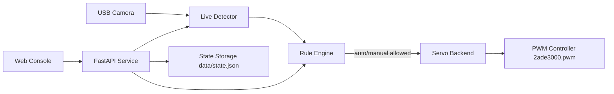
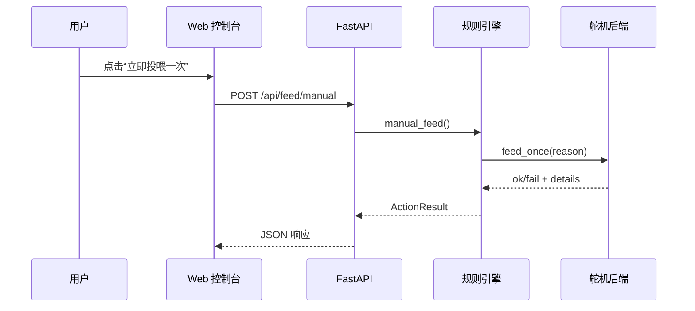
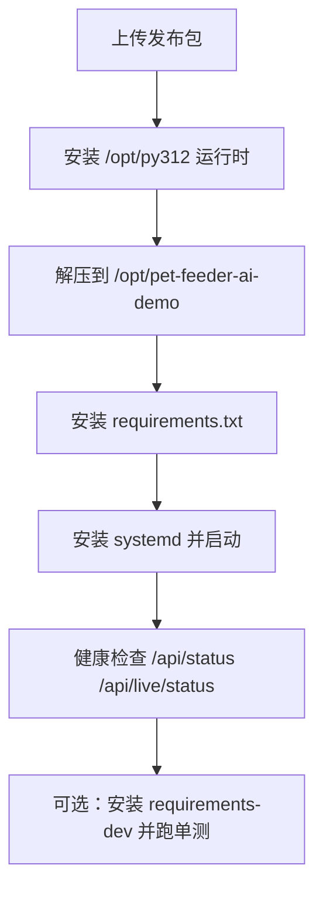

# 宠物自动投喂系统

> 基于 RK3576 平台的本地化宠物识别与自动投喂 Demo 文档（可离线部署）

---

# 修订记录

| 版本 | 日期 | 作者 | 变更说明 |
| --- | --- | --- | --- |
| v1.0 | 2026-11-13 | Chen11-cy / Copilot | 初版文档，按“智能家居中控系统”风格整理，补充新设备部署与验收流程 |

---

# 项目简介

宠物自动投喂系统用于在边缘设备上实现“识别到宠物后自动投喂”，并提供本地网页控制台用于手动投喂、状态查看和策略调参。

## 核心能力

1. 本地摄像头实时采集与目标识别（cat/dog/person）。
2. 自动投喂规则引擎（分数阈值、连续命中、冷却时间、每日上限、人员阻断）。
3. 手动投喂控制与运行状态可视化。
4. 舵机 PWM 控制（支持平滑扫动、多周期投喂）。
5. 离线部署（含 wheelhouse）与 systemd 自启动。

## 典型应用场景

1. 室内宠物定点自动喂食演示。
2. 边缘 AI + IoT 控制联动验证。
3. 新设备批量部署流程验证。

---

# 系统架构总览





---

# 开发资源汇总

## 目录结构

| 路径 | 说明 |
| --- | --- |
| app/ | 后端服务与核心逻辑（API、规则、舵机、视觉） |
| configs/ | 运行配置（demo_config.yaml） |
| models/ | 检测模型（YOLOv4-tiny cfg/weights） |
| web/ | 控制台前端页面 |
| scripts/ | 部署与测试脚本 |
| systemd/ | 服务单元文件 |
| wheelhouse_aarch64/ | 离线 Python 依赖包 |

## 关键服务

| 服务名 | 作用 |
| --- | --- |
| pet-feeder-ai-demo.service | 后端服务，提供识别/投喂 API |
| pet-feeder-kiosk.service | 设备端 Firefox kiosk 自启 |

## 关键接口

| 接口 | 说明 |
| --- | --- |
| GET /api/status | 运行状态、投喂计数、冷却、舵机就绪 |
| GET /api/live/status | 视频与推理运行状态 |
| GET /api/events | 最近事件（feed_success/feed_skip 等） |
| POST /api/feed/manual | 手动投喂 |
| POST /api/mode | 自动投喂开关 |

---

# 快速上手

## 一、设备前置条件

1. 目标设备为 RK3576 同型号同系统版本。
2. 具备 root 权限（adb shell 或 SSH）。
3. 摄像头和舵机硬件接线已完成。
4. 设备系统时间正确（非常重要，影响自动投喂时段判断）。

## 二、首次部署总流程



## 三、上传与解压

```bash
cd /home/alister/workspace
sha256sum -c pet-feeder-ai-demo-release-<TS>.tar.gz.sha256
adb push pet-feeder-ai-demo-release-<TS>.tar.gz /tmp/

adb shell '
set -e
cd /tmp
rm -rf pet-feeder-ai-demo-release-<TS>
tar -xzf pet-feeder-ai-demo-release-<TS>.tar.gz
mkdir -p /opt/pet-feeder-ai-demo
if command -v rsync >/dev/null 2>&1; then
  rsync -a --delete /tmp/pet-feeder-ai-demo-release-<TS>/pet-feeder-ai-demo/ /opt/pet-feeder-ai-demo/
else
  rm -rf /opt/pet-feeder-ai-demo/*
  cp -a /tmp/pet-feeder-ai-demo-release-<TS>/pet-feeder-ai-demo/. /opt/pet-feeder-ai-demo/
fi
'
```

## 四、安装 Python 运行时（新设备常见缺项）

先检查是否已存在：

```bash
adb shell 'test -x /opt/py312/bin/python && /opt/py312/bin/python -V || echo "missing /opt/py312/bin/python"'
```

若缺失，安装离线 Python3.12：

```bash
adb push /home/alister/workspace/h1/debian/QuecPi-QCLinux-BL01/prebuild/python3.12.tar.gz /tmp/pet-feeder-python312.tar.gz
adb shell '
set -e
mkdir -p /opt/py312
tar -xzf /tmp/pet-feeder-python312.tar.gz -C /opt/py312 --strip-components=2 ./usr
ln -sf python3.12 /opt/py312/bin/python
/opt/py312/bin/python -V
/opt/py312/bin/python -m pip --version
'
```

## 五、安装运行依赖并启动服务

```bash
adb shell '
set -e
cd /opt/pet-feeder-ai-demo
/opt/py312/bin/python -m pip install --no-index --find-links wheelhouse_aarch64 -r requirements.txt
/opt/py312/bin/python -m pip check

install -m 644 systemd/pet-feeder-ai-demo.service /etc/systemd/system/pet-feeder-ai-demo.service
install -m 644 systemd/pet-feeder-kiosk.service /etc/systemd/system/pet-feeder-kiosk.service
systemctl daemon-reload
systemctl enable --now pet-feeder-ai-demo.service pet-feeder-kiosk.service
'
```

## 六、健康检查（带重试，避免瞬时 rc=7 误判）

```bash
adb shell '
set -e
systemctl is-active pet-feeder-ai-demo pet-feeder-kiosk
for i in 1 2 3 4 5; do curl -fsS http://127.0.0.1:8787/api/status && break; sleep 1; done
for i in 1 2 3 4 5; do curl -fsS http://127.0.0.1:8787/api/live/status && break; sleep 1; done
'
```

## 七、可选：安装测试依赖并跑回归

说明：`httpx` 等测试依赖在 `requirements-dev.txt` 中，若只装 `requirements.txt`，单测可能报模块缺失。

```bash
adb shell '
set -e
cd /opt/pet-feeder-ai-demo
/opt/py312/bin/python -m pip install --no-index --find-links wheelhouse_aarch64 -r requirements-dev.txt
/opt/py312/bin/python -m unittest discover -s scripts -p "test_*.py"
'
```

---

# 参数与策略说明

## 推荐演示参数（configs/demo_config.yaml）

| 参数 | 建议值 | 说明 |
| --- | --- | --- |
| live.dnn_target | auto | 自动尝试 OpenCL，失败回退 CPU |
| rules.min_score | 0.55 | 降低漏检概率 |
| rules.required_hits | 2 | 提高自动触发灵敏度 |
| rules.cooldown_sec | 60 | 防连续误触发 |
| feeder.servo.sweep_steps | 24 | 舵机平滑扫动步数 |
| feeder.servo.feed_cycles | 2 | 每次投喂往返次数 |

## 自动投喂常见拦截原因

1. score below threshold（识别分数不足）
2. waiting for consecutive hits（连续命中不足）
3. person block active（检测到人，阻断中）
4. cooldown active（冷却未结束）
5. outside active time（不在时段内）

可通过 `GET /api/events` 快速定位。

---

# 部署验收清单

## 核心通过项

1. 服务状态：`pet-feeder-ai-demo` 与 `pet-feeder-kiosk` 均为 active。
2. 状态接口：`/api/status` 返回 `feeder_ready=true`。
3. 视频接口：`/api/live/status` 返回 `running=true`、`camera_opened=true`。
4. 手动投喂：`POST /api/feed/manual` 返回 `fed=true`。
5. PWM 采样可见 `800 -> 2200 -> 800` 峰值变化。

## 快速验收命令

```bash
adb shell 'systemctl is-active pet-feeder-ai-demo pet-feeder-kiosk'
adb shell 'curl -s http://127.0.0.1:8787/api/status'
adb shell 'curl -s http://127.0.0.1:8787/api/live/status'
adb shell 'curl -s -X POST http://127.0.0.1:8787/api/feed/manual -H "Content-Type: application/json" -d "{""reason"":""acceptance"",""bypass_cooldown"":false}"'
```

---

# 常见问题排查

## 1. 首次部署中断：缺少 /opt/py312/bin/python

现象：部署脚本在依赖安装阶段失败。  
处理：按“安装 Python 运行时”章节补装 `/opt/py312` 后重试。

## 2. 单测报错 No module named httpx

现象：`unittest` 执行时报 `httpx` 缺失。  
原因：只安装了 `requirements.txt`。  
处理：补装 `requirements-dev.txt` 后再跑测试。

## 3. 健康检查偶发 curl rc=7

现象：服务刚重启后立即 curl 失败。  
原因：端口短暂未就绪。  
处理：使用 3~5 次重试（间隔 1 秒）再判断。

## 4. 点击投喂但舵机不动

快速判断：
1. 若 API 返回 `fed=true` 且 PWM 有峰值，则软件链路正常，多半是硬件供电/接线问题。
2. 检查舵机独立供电、共地、信号脚与 PWM 控制器映射。

## 5. OpenCL 未启用

现象：`dnn_target_selected=cpu`、`opencl_enabled=false`。  
结论：系统自动回退 CPU，不影响功能正确性，仅影响性能。

---

# 应用演示素材建议（便于后续“图文并茂”发布）

建议在仓库新增 `docs/assets/`，并放入如下素材后替换本文占位：

1. `overview-ui.png`：控制台首页（左视频右控制）。
2. `status-api.png`：`/api/status` 返回截图。
3. `live-api.png`：`/api/live/status` 返回截图。
4. `manual-feed-success.png`：手动投喂成功返回。
5. `pwm-wave-sample.png`：PWM 峰值采样图。
6. `deployment-flow.png`：设备部署流程图（可由 Mermaid 导出）。

---

# 技术支持与贡献

1. Issue 反馈：提交日志、`/api/status`、`/api/live/status`、`/api/events` 片段。
2. 贡献建议：新增设备适配、模型替换、部署脚本自动化。
3. 合并流程：在个人 fork 提交后向上游仓库发起 PR。
